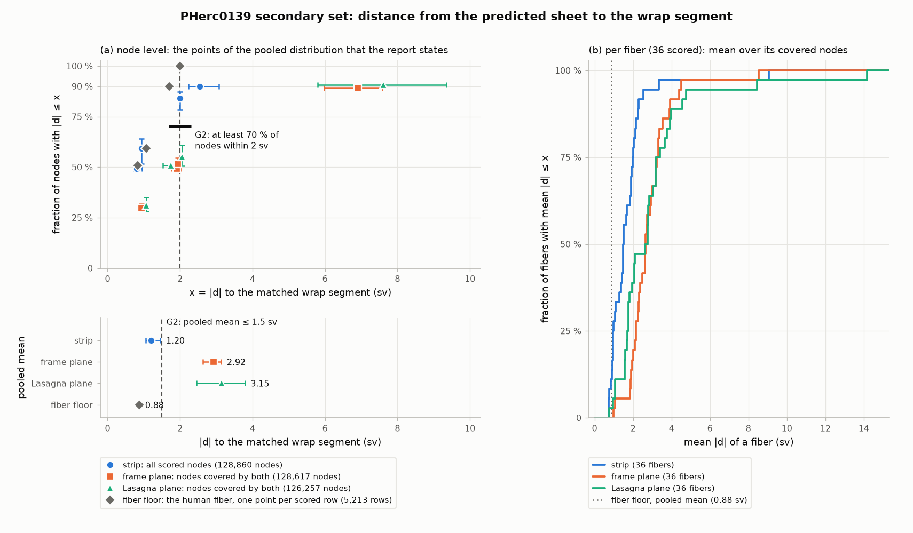
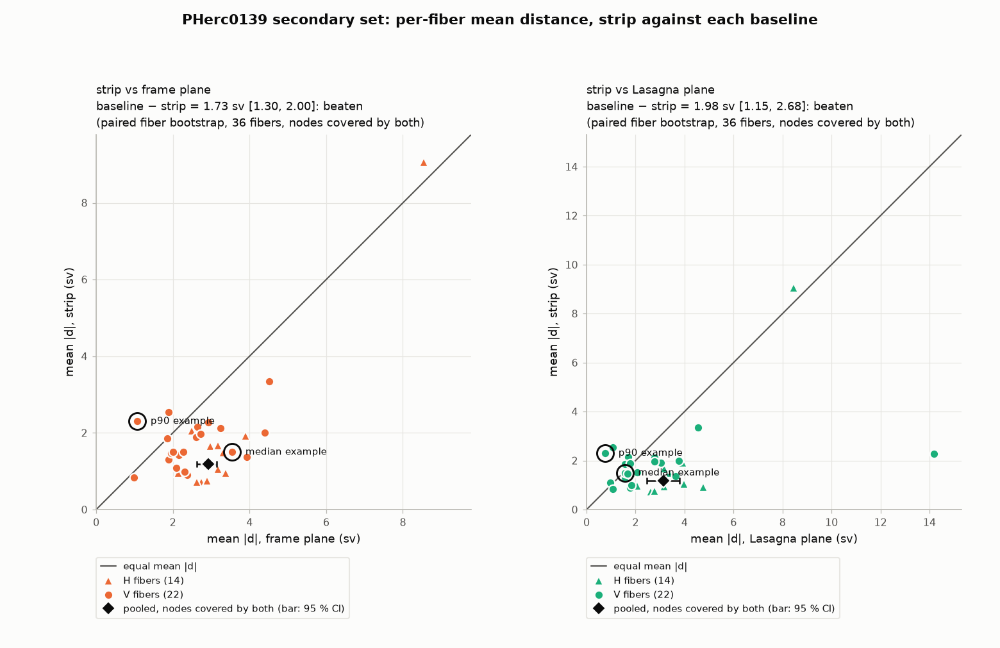
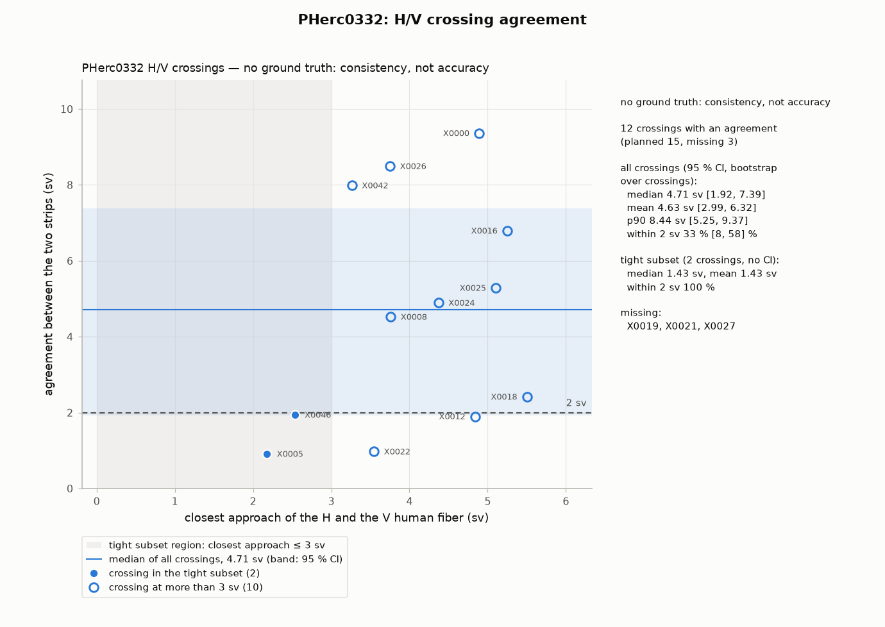
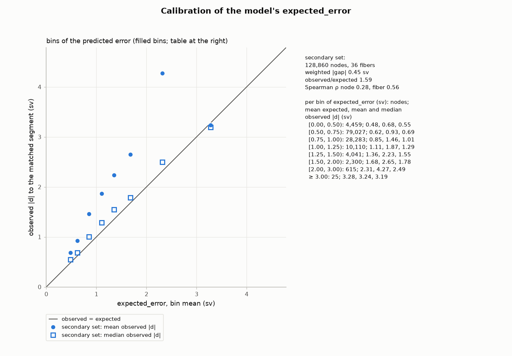
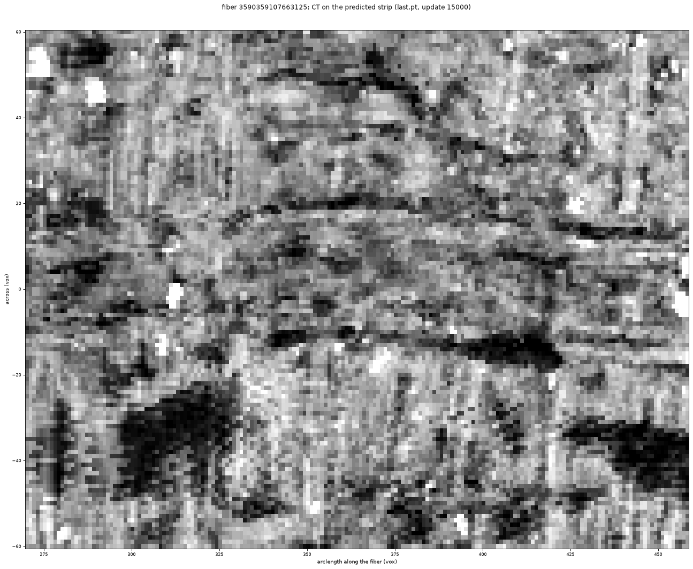
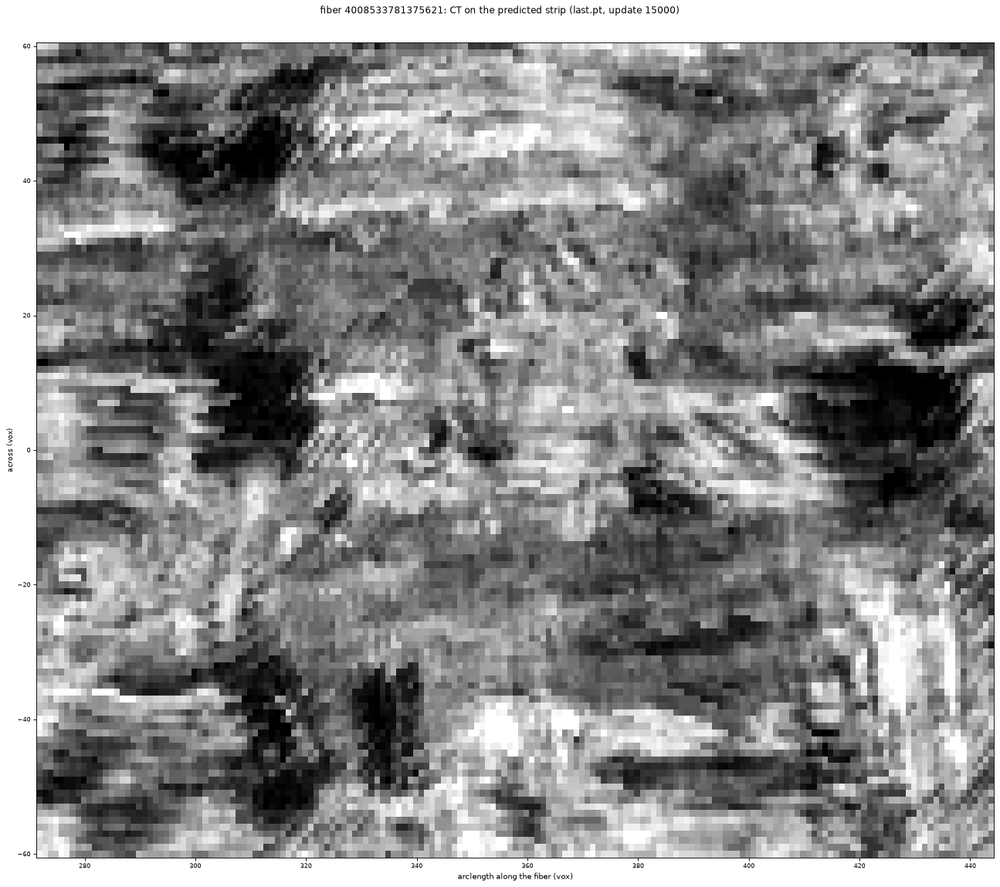

# fiber_strip_small_v1 beyond Paris 4

A pre-registered CPU evaluation of sean's (bruniss) sheet-strip model `fiber_strip_small_v1`
([villa #2110](https://github.com/ScrollPrize/villa/pull/2110)) on two scrolls outside its training data, as far as
public records show (the checkpoint's `run.json` fine-tunes on Paris 4 fibers from an earlier checkpoint, and no
training config in villa's `tracers/fibers/configs/`, for the fiber follower, frame model and sheet strip, lists
PHerc0139 or PHerc0332; configs of other villa models do): PHerc0139, scored against its wrap segments, and
PHerc0332, checked for consistency at fiber crossings.

**Status, 29 Oct 2026.** Pre-registration v3.2 was frozen on 29 Oct 2026 at 02:10:33 UTC
(`score/PREREG.md`, `score/FREEZE.txt`). It is the second erratum to v3 (frozen 28 Oct, 14:04 UTC;
`score/superseded_v3/`), after v3.1 (29 Oct, 00:34 UTC; `score/superseded_v31/`). Both errata were written before
any PHerc0139 or PHerc0332 strip of the plans was made, and neither changes the plans, the scorer or the runner. The
scored run ran from 02:13 to 03:40 UTC: every piece succeeded on its first attempt, and the frozen scorer wrote its
reports (`score/results/v3/`). The freeze time rests on local records (`FREEZE.txt`, file times, the run log). The
first record a third party can check is the GitHub push of the pre-registration at 02:20 UTC, 7 minutes after the
run started: by then 4 of the 73 strips existed, and no report existed until 03:39 UTC. The independent re-scoring
sample (`verification/`) was public at 02:30 UTC. The numbers in the run record, the G1' line, the tables under
Results, the bullets on the verdict, fiber floor, calibration, sensitivity and rejected strips, and the
missing-crossings line were filled from the scorer's reports and the run records by `tools/fill_results.py`, which
was written and tested before any report (local file times: it was first pushed with the results). Its template is
the README pushed before the results (commit a2f1b56, kept as `tools/fixtures/README_before_results.md`). Filled
lines and two table headers were then edited by hand in five places: the run record's "CPU time 1.41 h; CT fetched
0.00 GiB." became the inference wall time and the CT paragraph; the within-2 differences lost their "%" and their
column header now says percentage points; the PHerc0332 table's header was reworded; definitions and our reading were
added to the calibration line; and a stretch count and a note on the report's zero count were added to the
sensitivity line. Everything else written after the
results was written by hand, from the reports, the run records, `verification/`, `analysis/` and the sources each
passage names. Nothing was tuned after a strip was seen. Analyses decided after the results are kept apart and
labelled exploratory.

**Result.**
- **PHerc0139, secondary set** (labelled secondary, because the primary set failed its count gate): the pre-registered
  verdict is **secondary: transfers**. On 36 fibers (283 stretches, 128,860 strip nodes), the strips lie
  **1.20 sv (11.5 µm)** from the wrap segments as a mean over all strip nodes (95 % CI 1.05 to 1.46, fiber
  bootstrap), with **84 %** of nodes within 2 sv. The two baselines lie 2.92 sv (frame plane) and 3.15 sv
  (Lasagna-normal plane) away, and the human fibers themselves 0.88 sv. H fibers give 1.09 sv, V fibers 1.63 sv.
- **PHerc0332** (no ground truth; consistency, not accuracy): 12 of the 15 planned crossings have an agreement value.
  At those, the H and V strips are a median 4.71 sv apart. These fiber pairs pass within 6 sv of each other, so the
  two fibers can lie on neighbouring sheets or faces (PREREG 7). The two crossings within 3 sv agree to 0.91 and
  1.94 sv (mean 1.43 sv).
- **Read with** ([exploratory](#after-the-results-exploratory-not-pre-registered), decided after the results): the
  pooled mean weights nodes, and H fibers hold 80 % of them. With equal weight per fiber the mean is 1.75 sv (95 % CI
  1.41 to 2.27), and 19 of the 36 fibers are at or below 1.5 sv. At PHerc0332 crossings the strips are about as far
  apart as the two fibers themselves (median difference +0.35 sv).
- **`expected_error`** (the report's calibration block; pre-registered, not gating): it ranks fibers (Spearman
  0.56), and the mean observed \|d\| is 1.59 times the expected error. Our reading after the results: per bin, the
  median \|d\| is within 0.2 sv of it, so the excess is a tail of large errors.

- PREREG v3.2 sha256 `dffa97b9dffb7cd9b69d6cdc66fa247f00a57de6a208db71fdc098034b59812e`
- FREEZE.txt sha256 `d2bf1f7b7612bee6b22925d3de123a65ec792642bfa0fd8980ac8dfda51454be` (v3.1: `7c8be79970c1a98d3b097c0988ea0b53d7a5354379e78f7f5e11abc851dbd559`,
  kept as `score/superseded_v31/FREEZE_v31.txt`; v3: `5309debbbeeb6ed7401badbbd163809b9c4632838c71f7eded8945d0783db8d5`,
  kept as `score/superseded_v3/FREEZE_v3.txt`)
- Check them: `python verify_freeze.py` (see [How to reproduce](#how-to-reproduce)).

**Outputs.** The 73 strips are the release
[`strips-v3`](https://github.com/TAUIL-Abd-Elilah/fiber-strips-beyond-paris4/releases/tag/strips-v3) (CC BY-NC 4.0;
`manifest.json` maps each strip to its fiber and to its stretches or crossing windows). In this repo: the scorer's
reports (`score/results/v3/`), the run records (`score/runs/v3/`), the figures (`figures/`), the independent
re-scoring (`verification/`) and the exploratory analyses (`analysis/`).

**Units.** sv = one level-2 voxel of the 2.4 µm scans = 4 base voxels = 9.596 µm on PHerc0139 and PHerc0332
(9.6 µm on Paris 4). It is the strip model's "patch voxel".

## Question

**Primary question (PHerc0139).** Run unchanged on human-traced fibers of PHerc0139, does `fiber_strip_small_v1`
place the sheet where the PHerc0139 wrap segments are? The segments are meshed on the same 2.399 µm scan as the
fibers. A strip is scored only where the human fiber itself lies on a segment.

**Secondary question (PHerc0332, no ground truth; separate from the PHerc0139 secondary set).** Where an H fiber
and a V fiber cross, do their two strips agree?

**Reference on Paris 4.** villa's `tracers/fibers/README.md` (at 6f2024569) gives its numbers for checkpoints other
than the one tested here (`fiber_strip_small_v1` is `sheet_strip_paris4_slim50k_v3`, update 15000): validation error
1.006 / 1.117 voxels (full / observed tube) for the `paris4_slim50k_v2_ft` run, and, for an update-16000 checkpoint
on validation fiber 469373, 1.22 voxels mean error against 6.89 for the frame plane, with 82 % of points within
2 voxels. The tested checkpoint's own `log.jsonl` (update 15000) gives 0.99 / 0.94 voxels (full / observed) against
5.42 / 4.91 for the frame plane, on the 8 validation batches of 32 decisions drawn during its training: a different
and smaller set than those behind villa's numbers above, so the two are not directly comparable.

## Why

Paul's progress update of 26 Oct 2026 (our paraphrase): the team sees reliably thickening 1D fibers into narrow 2D
patches as the most promising use of sean's neural tracing; it is done with Paris 4 for now; the human fiber
scaffolds of PHerc0139 and PHerc0332 are finished and PHerc1451's is under way. Strips, though, had been published
and scored only for Paris 4 (see Prior work below).

So before strips are used on those scaffolds, it helps to know how well the model does off Paris 4. PHerc0139 has
38 wrap segments meshed on the same volume as its 620 human fibers (39 segment folders; one has no mesh on that
volume), so it gives an independent reference. PHerc0332 has no segments; there we can only check that strips agree
with each other.

**Prior work.** As far as I could find, as of 29 Oct 2026, nobody had published such an evaluation of
`fiber_strip_small_v1`, or strips for PHerc0139, PHerc0332 or PHerc1451. I searched:
- ScrollPrize/villa issues, PRs, comments, discussions and commits, and GitHub search;
- Hugging Face, scrollprize.org and the Substack;
- the dl.ash2txt.org listings and the open-data S3 `representations/` of those scrolls;
- the Discord server, with its own search for "fiber_strip", "strips 0139", and "strip" since 14 Oct (18 messages).

The Discord hits are sean's announcement and uploads of the Paris 4 strips, questions about the model, and uses of
the word in other senses. None reports an evaluation off Paris 4. One post (20 Oct, in a thread on automated fiber
volumes) has an image named "fiber strip" and no text; I could not place it. I did not open the `fibers_db` object
stores. The nearest earlier work is villa #2163, the strip model on 10 Paris 4 fibers, and
modaribrahim/fiber-tracer-heldout-eval, the fiber tracer (not the strip model) on PHerc0139, PHerc1451 and
PHerc0332. Reading the thread on automated fiber volumes also found, on 20 Oct, hja's surfaces built from H/V fiber
intersections and Qual's from H and V fiber splines that constrain each other (neither uses the strip model), and
sean's remark that strips could be used to estimate winding counts from H-on-V crossings; none is a strip
evaluation.

On 29 Oct 2026 the organizers' `spiral_datasets` held strips for Paris 4 only (`PHercParis4/fiber_strips/101526/`).
The PHerc0139 and PHerc0332 folders held tracks skeletonized from the surface-m7 prediction (PHerc0139's on volume
20250728140407), and there was no PHerc1451 folder.

## Design

Everything here is fixed in `score/PREREG.md` (v3.2) and was frozen before any PHerc0139 or PHerc0332 strip was
run against the plans. Section numbers below refer to it.

### Model and inference (PREREG 2)

- **Code:** villa 6f2024569, plus #2163 (the Windows port by slchicoineau-creator and Baz248, applied unchanged),
  plus our 20-line normalization patch for scrolls other than Paris 4 (`patches/`). Since v3.1, `FREEZE.txt` pins
  the sha256 of every file of the worktree that differs from 6f2024569 (9 files), of the patches and of the
  checkpoint files, and the runner's freeze check also requires the worktree to be at 6f2024569 with exactly those
  files changed. Since v3.2 it also pins the relaunch wrapper that writes the run's final status
  (`score/runs/relaunch_v3.ps1`).
- **Checkpoint:** `scrollprize/fiber_strip_small_v1@7bd163a22c839ff312879ae1916195d0c9729c0e` with its frame model
  `heading_model.pt`. Not redistributed; `fetch_inputs.py checkpoint` downloads it and checks its sha256. The pins
  were checked against the Hugging Face API at that revision (LFS sha256 of the two `.pt` files, git blob ids of
  `config.json` and `run.json`; PREREG 10.8 item 7).
- **Runs:** one `sheet_strip.infer` process per piece, one at a time, CPU only (`CUDA_VISIBLE_DEVICES=-1`,
  `--device cpu`), 8 torch threads, batch 32, villa's default settings (`--step 8 --blend 16 --trim 75`).
- **Pieces, not whole fibers.** A full run of all 0139 fibers would need about 48 CPU-h and 183 GiB of CT, so only
  the matched stretches are run, each as a piece of its fiber with `--arc`. The decision heads are placed on the
  full run's own (kink-repaired) arclength grid. A test runs villa's `infer.py` head code on every run-plan row and
  requires exactly the planned decisions. Head positions match a full run's within 1 sv in every piece except
  five; three of those are in the run sets (P0104 at 1.01 sv; 0332 pieces C0001 at up to 5.7 sv and C0004 at up to
  1.3 sv) (PREREG 4.6).
- **Is a piece run the same as a full run? (v3.1 and v3.2, PREREG 10.7 and 10.8.)** Tested on Paris 4: three G0
  fibers cut into pieces the same way and run with the same `infer.py` command. On the rows a stretch would score,
  the piece strip equals the full-fiber strip within 0.001 sv (max over 425 nodes); rows at the piece's ends, which
  take decisions from outside the piece and are never scored, differ by up to 2.9 sv. Not quite everything else is
  equal, though (v3.2): the first decision of a piece that starts mid-fiber differed from the full run's (heights by
  up to 0.42 sv, cause not identified). It can reach at most the first one or two rows of a window, with at most
  about 7 % of their weight (0.0085 sv on the Paris 4 row tested), in 2 of 2 primary, 17 of 46 secondary and 8 of 25
  PHerc0332 pieces. One input is not covered by that test: `infer.py`
  also gives the model every fiber point inside the crop, so a part of the fiber outside the piece that loops back
  into the crop changes the input. From fiber geometry, this can happen for 121 of the 2,207 secondary heads that
  feed scored rows (6 pieces) and 112 of the 531 PHerc0332 ones (6 pieces), and for none in the primary set. Its
  effect is not measured; the affected heads are listed in `score/results/erratum_v31/geometry_checks.json`.
- **The scorer on real output (v3.1).** It had only read synthetic strips. On six real Paris 4 `infer.py` outputs it
  reproduces 100 % of the strip nodes from the saved decisions, so the frame-plane baseline is available, and it
  scores them end to end. One of them is now a test fixture (`score/tests/fixtures/paris4_real`).

### Sets

| Set | Rule | Fibers | Stretches or windows | Pieces | Decisions | New CT |
|---|---|---|---|---|---|---|
| 0139 primary | on one segment, \|d\| ≤ 2 sv, ≥ 2.5 mm | 2 (both H) | 2 stretches, 7.42 mm | 2 | 58 | 0.27 GiB |
| 0139 secondary, all matched | as primary, ≥ 40 sv (0.384 mm) | 57 (25 H, 32 V) | 1,075 stretches, 710.5 mm | 182 | 12,725 | 24.3 GiB |
| 0139 secondary, run subsample | seeded subsample, CT cap 9.6 GiB | 36 (14 H, 22 V) | 284 stretches on 30 segments, 198.1 mm | 46 | 3,513 | 9.60 GiB |
| 0332 crossings | H/V pairs within 6 sv; 48 found, 45 with both windows | 24 | 15 crossings (7 / 3 / 5 by z tercile, incl. 3 tight ≤ 3 sv), 30 windows | 25 | 558 | 1.97 GiB |

Sources: `score/results/matched_stretches.json`, `matched_stretches_secondary_run40.json`,
`crossings_0332_plan.json`, and the run plans `score/results/runplan_*.tsv`.

- 5 of the 620 PHerc0139 fibers and 2 of the 255 PHerc0332 fibers have fewer than 2 control points and are not used.
- The secondary rule's 40 sv minimum is the `--min-run 40` sean used to match fibers to patches for this model's
  own training. It was chosen after the primary count (2 fibers) was known, from fibers and segments only, before
  any strip. It is labelled secondary everywhere.

### Metrics (PREREG 5)

- `d`: signed normal distance from a strip node to the matched segment's bilinear surface, positive outward.
- A strip row is scored if its centre is within 30 sv of its fiber and its arclength falls in a matched stretch.
  It is scored against that stretch's segment only, so a strip on the next winding counts as an error of about one
  gap (12 sv). A fiber needs at least 25 covered nodes.
- Reported: mean, median and p90 of \|d\|, the fraction of nodes within 1 and 2 sv, and the signed mean (bias),
  pooled and per family (H, V).
- Uncertainty: cluster bootstrap over fibers, 2000 replicates (1000 for median and p90), seed 20261028; the paired
  baseline comparison uses seed 20261029 and fibers with at least 25 nodes covered by both surfaces, the PHerc0332
  crossing summary seed 20261030.
- Also: the human fiber's own distance to the mesh (fiber floor), calibration of the model's `expected_error`,
  and sensitivity cuts (unflagged stretches, per annotator, per family).

### Baselines (PREREG 5.5)

Both use the same nodes and the same distance.

- **(a) Frame plane:** the u = 0 plane of each decision's frame, stitched like the strip. This is the comparison
  behind the 6.89 vs 1.22 of villa's fibers README (Question).
- **(b) Lasagna-normal plane:** the plane through the fiber point that holds the fiber tangent, with its normal
  from the open-data Lasagna L2 normals.
- "Beaten" means the paired cluster-bootstrap 95 % CI of (baseline mean \|d\| − strip mean \|d\|) lies above 0.

### Gates (PREREG 6)

- **G1, ground truth adequate** (fibers and segments only): at least 30 fibers with a matched stretch, NF_match
  ≤ 2 sv and NF6 ≤ 2 sv. NF_match is the median \|d\| of the human fiber over the matched stretches; NF6 the same
  over all runs within 6 sv of a segment, which does not depend on the 2 sv window.
  - Primary: **fails**. 2 fibers (NF_match 0.78 sv, NF6 1.76 sv). There is no PHerc0139 accuracy claim from the
    primary set; its 2 strips are reported as case studies.
  - Secondary: passes. 57 fibers, NF_match 0.82 sv, NF6 1.76 sv.
- **G1', at scoring time:** at least 30 fibers actually scored, each with at least 25 covered nodes. The secondary
  run subsample has 36 fibers, so up to 6 can be lost to failed runs or coverage.
- **G2, transfers or degrades** (only if G1 and G1' pass): "transfers" needs a pooled mean \|d\| ≤ 1.5 sv, at least
  70 % of nodes within 2 sv, and both baselines beaten. Anything else is "degrades". A baseline that cannot be
  computed counts as not beaten. The secondary verdict always carries the prefix "secondary:".
- **PHerc0332:** no gate. Per crossing, the agreement is the mean of the two strips' median \|d\| to each other
  within 30 sv of the crossing. It is labelled "no ground truth: consistency, not accuracy".

### Subsample rule (PREREG 4.8)

- **Caps:** 0139 primary 8 CPU-h and 8 GiB of new CT; 0139 secondary 8 CPU-h and the CT cap of amendment A1;
  PHerc0332 2 CPU-h, 2 GiB and at most 60 crossings.
- **Units:** pieces (PHerc0332: crossings). **Strata:** (the piece's segment, family), where the piece's segment is
  the one holding the most total stretch length in the piece; for PHerc0332, (tight crossing yes/no, z tercile).
  v3's text said "segment of the piece's longest stretch", which is not what the code did; read that way, the rule
  would have given a 9.1 GiB cap and a different set of 45 pieces. The frozen set, made by the code, stays (PREREG
  10.7, item 1).
- **Order:** strata in sorted key order; within a stratum, units sorted by id and permuted by
  `numpy.random.default_rng(20261028)`.
- **Selection:** round robin over the strata, preferring fibers not yet chosen. A unit is taken if the cumulative
  CPU time (at 1.35 decisions/s) and new CT stay within the caps; otherwise it is passed over for good.
- The primary set is within its caps and is not subsampled.

### Amendments (PREREG 10)

| Version | Frozen (UTC) | What changed |
|---|---|---|
| v1 | 27 Oct 2026, 19:36 | Whole-fiber selection (≥ 70 % of the fiber within 2 sv). Its G1 run, after the freeze, found 0 fibers (`score/superseded_v1/`). |
| v2 | 28 Oct 2026, 12:27 | Stretch rule; NF6 in G1; pieces with `--arc`; caps and the seeded subsample; the secondary set; row window 10 → 30 sv; fiber-level bootstrap clusters; 0332 crossing tolerance 3 → 6 sv. Decided after v1's G1 numbers and ground-truth diagnostics, before any strip. An independent verifier failed v2 before any strip was run against its plans (`score/superseded_v2/`). |
| v3 | 28 Oct 2026, 14:04 | Decided on 28 Oct from the verifier's report, plan geometry and ground truth only, before any 0139 or 0332 strip was run against a plan. **P1:** v2 lost the last decision head of most pieces; v3 sets END = START + 16 (n − 1) + 1 sv and tests exact equality with `infer.py`'s head code. **P2:** heads moved from the raw JSON arclength to the full run's kink-repaired grid. **P3:** wording, and two rules in the code now stated (5-node crossing rule, 10 sv Lasagna rule). **A1:** secondary CT cap from 8 GiB to 9.6 GiB, the smallest cap on 8.0 to 13.0 GiB (step 0.1) giving at least 36 fibers, so that one lost fiber cannot fail G1'. **A2:** CPU time given as a range, 3.27 to 3.56 decisions/s idle and 1.35 under load. **Identity fix:** `--space` for fibers without a coordinate space (changes one unmatched fiber's id). |
| v3.1 | 29 Oct 2026, 00:34 | Erratum, from an independent adversarial check of v3, before any strip of the plans. No plan, scorer or runner change (50 of v3's 52 frozen files keep their sha256). **Wording:** the strata rule (the segment with the most stretch length, not the segment of the longest stretch); the crossing rule (nearest V sample per H sample; an exhaustive search finds the same 48 pairs); P0104's other heads ≤ 0.235 sv. **Rules now stated:** bootstrap seeds 20261029 and 20261030, the 25-node rule of the paired comparison, the row-centre fallback, "new CT" = not cached at plan time, `--arc` of the run plan authoritative, one retry per failed piece. **G0 limit:** G0 ran before the normalization patch, which is a no-op on Paris 4. **Pins:** villa worktree, patches, checkpoint. **Checks on Paris 4:** the scorer on real `infer.py` output; a piece run against the full run. **Recorded:** the runner's stops on low disk, the CT cache moves, an accidental shutdown, the prefetch-only pass, and two PHerc0332 smoke strips of a fiber in no plan made by a separate build. |
| v3.2 | 29 Oct 2026, 02:10:33 | Erratum, from a second independent adversarial check (of v3.1), before any strip of the plans. Disclosure and wording only; no plan, scorer, runner or pin of the strip code changes. **Listed:** a byte-identical rerun of the 0139 smoke strip by the setup's verifier; every file of the separate build's smoke test (its exploratory crossing step was given no strip). **Corrected:** the piece-run claim (the first decision of a piece can differ; see Design); the shutdown history (two power cycles); the crossing point (the midpoint of the closest H and V samples). **Pinned:** the relaunch wrapper, whose code is that of its first version, and the prefetch-only pass. **Checked:** the checkpoint pins against Hugging Face itself. **Declared:** all local paths in frozen files. |
| after v3.2 | | None. The run used the frozen runner, plans and settings unchanged, and every piece ran once and succeeded. Added after the freeze, outside the gates: the independent re-scoring sample (`verification/`, published before the results; the re-scorer's version 1.1, which added the solver bounds, was written after the reports existed, by agents barred from reading them; later edits by the author, made after the reports had been seen, changed only its docstring, version string and exit code on an input error), reporting tools (`tools/`), and, after the results, a run-integrity audit and exploratory analyses (`analysis/`). |

Before the freeze exactly one PHerc0139 strip existed: a smoke test of the setup run (fiber
`dj_20260902T151037604_000001`), plus a byte-identical rerun of it by the setup's independent verifier. That fiber
has no matched stretch, and the strip was never scored (PREREG 10.3). A separate full-PHerc0332 build made two smoke
strips of one PHerc0332 fiber (`kb_20260824T164423720_000066`) that is in no plan and in none of the 48 crossings;
nobody opened them, and that build's exploratory crossing step was given no strip and computed nothing (PREREG
10.7, item 8).

## G0 reproduction (Paris 4)

Before running anything new, we checked that the pinned code on CPU and Windows reproduces the organizers'
published Paris 4 strips (`results/g0.json`).

- **Selection:** 10 fibers (5 H, 5 V) by a seeded rule written before any strip was made
  (`results/g0_selection_rule.txt`, seed 20261027): published v3-checkpoint strips of 2.5 to 6 mm, spread over z
  quintiles and radius (`results/g0_selected.json`).
- **Gate:** at least 9 of 10 strips with a mean node-to-node distance ≤ 1 patch voxel, nodes matched by grid index.
- **Result: 10 of 10 pass.** Mean of the 10 means 0.012 voxels; worst mean 0.029 voxels; worst p99 0.123 voxels.
  Every strip has the published shape and layout, and the valid-node masks agree exactly (IoU 1.0). All 10 are also
  inside #2163's tighter band (mean ≤ 0.05, p99 ≤ 0.5).
- **Setup:** CPU only, fp32 (autocast is off on CPU; the published strips were made on GPU in bf16), Windows 11,
  Python 3.14.6, torch 2.13.0+cu126 with CUDA hidden, 16 torch threads, villa 6f2024569 + #2163. A streamed pass and
  a cached pass gave bitwise identical strips.

| Fiber | Family | Length | Decisions | Nodes | Mean distance | p99 | Mask IoU |
|---|---|---|---|---|---|---|---|
| 238475 | H | 3.52 mm | 22 | 1,350 | 0.029 | 0.123 | 1.0 |
| 329464 | V | 4.35 mm | 27 | 1,875 | 0.011 | 0.043 | 1.0 |
| 435199 | H | 3.33 mm | 21 | 1,225 | 0.008 | 0.027 | 1.0 |
| 307062 | V | 3.24 mm | 20 | 1,175 | 0.009 | 0.035 | 1.0 |
| 498336 | H | 3.68 mm | 23 | 1,450 | 0.015 | 0.073 | 1.0 |
| 523953 | V | 2.96 mm | 18 | 975 | 0.010 | 0.038 | 1.0 |
| 757072 | H | 4.68 mm | 29 | 2,100 | 0.010 | 0.044 | 1.0 |
| 740130 | V | 3.02 mm | 19 | 1,025 | 0.012 | 0.041 | 1.0 |
| 838073 | H | 3.06 mm | 19 | 1,050 | 0.009 | 0.035 | 1.0 |
| 778459 | V | 4.80 mm | 30 | 2,175 | 0.008 | 0.028 | 1.0 |

Distances in patch voxels (9.6 µm). The published strips are not redistributed;
`data/g0/published/manifest.json` lists the zip members we compared (names, sizes, CRC-32) from
`https://dl.ash2txt.org/datasets/spiral_datasets/PHercParis4/fiber_strips/101526/all_strips.zip`.

**Throughput** (shared machine, CT cached): 1.35 decisions/s with 16 threads and batch 32; 1.47 with 16 threads and
`--crop-threads 4`; 1.33 with 8 threads and batch 16. An idle rerun measured 3.27 to 3.56 decisions/s.

**Errata** (`results/g0_errata.md`; none changes the verdict):
1. CT for a whole scroll at the r = 170 footprint is 183.0 GiB (PHerc0139) and 36.4 GiB (PHerc0332). The 157 and
   32 GiB first stated are the r = 120 figures.
2. The 10-fiber G0 AFV is 147,456 bytes, not 0.36 MB.
3. `patches/applied_pr2163_on_6f2024569.diff` omits #2163's two new test files. The complete diff is
   `patches/applied_pr2163_on_6f2024569_with_tests.diff`.
4. "4 threads: 1.47 decisions/s" was 16 torch threads with `--crop-threads 4`.
5. The RAM peak was about 4.1 GB.

## Results

The detached runner (`score/runs/v3/run_all.ps1`) verified `FREEZE.txt`, checked the CT, ran the pieces and then
the frozen scorer. The scorer's reports are shipped byte for byte: `score/results/v3/primary_case_studies.json`,
`secondary_report.json` and `crossings_0332_report.json`. Each records the sha256 of the scorer and of PREREG v3.2 in
its `provenance`, along with the workspace paths of the run (`C:/VesuviusTemp/strips`). The runner's log, status,
stage outputs and per-piece records (argv, timings, villa's stdout) are in `score/runs/v3/`. In `log.txt` the scored
run starts at line 411 (29 Oct 02:13:16 UTC, pid 76004). Lines 1 to 410 are the five runner starts of 28 Oct under
the v3 freeze, which all stopped in the CT prefetch before any inference: four ended with "DONE rc 3" on low disk,
and the last was stopped by hand to move the cache (PREREG 10.7 item 7). `runner_pid.txt` (43784) is left from the
first of them.

**Run record.** Started 29 Oct 2026 at 02:13:16 UTC, finished 29 Oct 2026 at 03:40:54 UTC, exit code 0. Pieces
ok / failed: primary 2 / 0, secondary
46 / 0, PHerc0332 25 /
0. Decisions 4,129 of 4,129 planned. Inference wall time
1.41 h: one piece at a time, 8 threads, below-normal priority, on a machine shared with other
jobs; process start-up included.

**CT.** The runner's prefetch stages found nothing to fetch: the three sets' CT (11.7 GiB of new CT; the per-set
figures under Sets add to 11.8 GiB because the primary and secondary sets share 79 chunks) had been fetched before
the run with the same frozen helper (PREREG 10.7 item 7). During inference, villa's own reader
fetched 2 more PHerc0139 chunks (2 × 2 MiB) from the public open-data store while secondary piece P0083 ran (02:49
to 02:51 UTC). They lie outside the prefetched r = 170 footprint. The runner does not log such fetches; the audit
found them in the cache. `HF_HUB_OFFLINE=1` covers the checkpoint, not the CT.

**Run-integrity audit** (after the run, read-only, outside the gates). It found one wrong count in a report (item 2
below) and no problem that changes a headline number, a gate or the verdict:
- The run verified `FREEZE.txt` at its start (109 files, 0 differ; villa worktree at 6f2024569 with exactly the 9
  pinned changed files), and all 109 files re-hash identical after the run.
- Each of the 73 pieces ran once, with its run plan's exact `--arc` and the frozen arguments, and each `strip.npz`
  holds exactly the planned decisions (58 / 3,513 / 558).
- The normalization patch was active in all 73 pieces: each piece's output has villa's line "CT per-crop z-score
  bound to" the PHerc0139 or PHerc0332 store.
- CPU only (`CUDA_VISIBLE_DEVICES=-1` in all 73 records); the checkpoint files at 7bd163a2 are unchanged.
- The reports' provenance matches `FREEZE.txt`: scorer, PREREG and match files. Nothing in `score/` changed after
  the freeze except run outputs. The repo's copies of the reports are byte-identical to the run's.

It also found four smaller issues, none affecting a headline number:
1. The 2 live CT chunks above.
2. A reporting bug in the frozen scorer: the sensitivity block "unflagged stretches" gives `scored_stretches` = 0.
   `aggregate()` compares string stretch ids with integer indices (`score/score_strips.py`, lines 1533 to 1534).
   The block's node statistics are right, since they use a different, correct filter. The true count is 275 of the
   276 unflagged run stretches.
3. `crossings_0332_report.json` records no sha256 of its plan. `FREEZE.txt` pins the plan, and it re-hashes
   identical after the run.
4. Cosmetic: the runner's log line "(+ #2163 + normalization patch, as G0)" is wrong about G0, which ran without the
   patch (PREREG 10.7 item 3). `status.json` carries forward a prefetch block from 28 Oct.

**Independent re-scoring** (`verification/README.md`). The sample was published at 02:30 UTC, before any result. The
code was written from PREREG's text without importing the scorer: version 1.0 during the run, and version 1.1 (which
added the solver bounds below) after the reports existed, by agents barred from reading them. Later edits by the
author, made after the reports had been seen, changed only its docstring, version string and exit code on an input
error. It was run on the outputs at 06:10 UTC, and again, with the same verdicts and values, after a correction of
its docstring (version 1.1.1). Of 224 comparisons:
- 213 agree within 0.001 sv. Among them: the primary pool, 13 of the 15 sampled pieces, every crossing's point,
  closest approach and missing status, and a ground-truth check for 190 of 192 stretches against numbers the frozen
  plan recorded before any strip existed.
- 10 agree within the solver bounds of version 1.1, set before the comparison: 7 crossing agreements (the largest
  gap is 0.16 sv, X0000), 2 ground-truth stretches (S0039, S1061), and piece P0126.
- 1 differs: piece P0033. Of the 26,675 nodes on its scored rows, the scorer covers 26,664 and the independent code
  26,650. For the independent code, the 14 nodes only the scorer covers lie off the mesh's edge; in the scorer they
  lie about 9 sv away, likely on another layer or wrinkle of the mesh. The piece's mean differs by 0.004 sv, and the
  pooled secondary mean would change by about 0.001 sv.
- The PHerc0332 share within 2 sv is 25 % there against the scorer's 33 %: X0046 is 2.02 against 1.94 sv, either
  side of the line.

No gate changes.

### PHerc0139 primary: 2 case studies (G1 failed, no accuracy claim)

| Stretch | Fiber | Segment | Length | Nodes | Mean \|d\| | Within 2 sv | Bias | Frame plane mean \|d\| | Lasagna plane mean \|d\| | Fiber floor |
|---|---|---|---|---|---|---|---|---|---|---|
| S0000 | `kb_20260904T021448778_000085` (H) | w044 | 3.73 mm | 2,450 | 0.56 | 100 % | −0.38 | 2.37 | 2.27 | 0.96 |
| S0001 | `lt_20260918T092404850_000160` (H) | w054 | 3.68 mm | 2,400 | 0.94 | 93 % | −0.80 | 3.16 | 3.14 | 0.66 |

### PHerc0139 secondary (labelled secondary)

**G1':** 36 of 36 fibers scored with at least 25 covered nodes, so G1'
passes.

| | Fibers | Nodes | Mean \|d\| [95 % CI] | Median | p90 | Within 1 sv | Within 2 sv | Bias |
|---|---|---|---|---|---|---|---|---|
| All | 36 | 128,860 | 1.20 [1.05, 1.46] | 0.80 | 2.54 | 59 % | 84 % | −0.10 |
| H | 14 | 103,102 | 1.09 [0.95, 1.34] | 0.72 | 2.29 | 64 % | 87 % | −0.13 |
| V | 22 | 25,758 | 1.63 [1.41, 1.92] | 1.22 | 3.27 | 42 % | 73 % | +0.02 |

| Baseline | Mean \|d\| | Baseline − strip [95 % CI] | Within-2 difference (percentage points) | Beaten |
|---|---|---|---|---|
| (a) Frame plane | 2.92 | +1.73 [+1.30, +2.00] | +33 (strip − baseline) | yes |
| (b) Lasagna-normal plane | 3.15 | +1.98 [+1.15, +2.68] | +30 (strip − baseline) | yes |

- **Per family** (the report's paired comparison per family, not gating): baseline − strip is +1.96 [+1.61,
  +2.21] sv (frame plane) and +2.36 [+1.54, +3.07] sv (Lasagna plane) for H, and +0.79 [+0.53, +1.05] and +0.48
  [+0.18, +0.77] sv for V. The V strips beat both baselines too, by less.
- **Verdict:** secondary: transfers.
- **Fiber floor** (the human fiber's own \|d\| on the scored rows): mean 0.88 sv, median 0.83 sv over 5,213 rows.
- **`expected_error` calibration:** weighted gap 0.45 sv (the bins' \|mean observed − mean predicted\|, weighted by
  their node counts; PREREG 5.7); observed / predicted (mean over mean) 1.59; Spearman rho 0.28 (nodes), 0.56
  (fibers). Our reading after the results: per bin of `expected_error` (fig 4), the median observed \|d\| is within
  0.2 sv of the bin's mean expected error (1.06 to 1.18 times it) in every bin below 3 sv, while the mean observed
  \|d\| is 1.41 to 1.85 times it: the excess is a tail of large errors.
- **Sensitivity** (not gating): unflagged stretches mean \|d\| 1.22 sv [1.07, 1.46], 84 % within 2 sv (36 fibers, 275 stretches; the report's stretch count for this subset reads 0, a scorer bug: see the audit above); per annotator
  dj: mean \|d\| 1.01 sv [0.78, 2.36], 89 % within 2 sv (5 fibers); kb: mean \|d\| 1.17 sv [0.97, 1.53], 85 % within 2 sv (15 fibers); lt: mean \|d\| 1.38 sv [1.11, 1.95], 79 % within 2 sv (16 fibers).
- **Rejected strips** (unit or association errors): none; other skips: 1 (P0005: no strip row inside a matched stretch).
- **Why P0005 has no row** (checked after the run): its only stretch, S0026, covers the first 43 sv of its fiber. A
  run trims 75 sv at a true fiber end, as a full run does (PREREG 4.6), so no run could score S0026. The fiber is
  still scored through P0006, so 36 of 36 fibers and 283 of 284 stretches are scored.

### PHerc0332: H/V crossing agreement (no ground truth: consistency, not accuracy)

| | Crossings with a value | Mean agreement, sv [95 % CI] | Median, sv | p90, sv | ≤ 2 sv |
|---|---|---|---|---|---|
| All 15 planned | 12 | 4.63 [2.99, 6.32] | 4.71 | 8.44 | 33 % |
| Tight subset (3, ≤ 3 sv) | 2 | 1.43 | 1.43 | | |

Missing crossings: 3 (X0019, X0021, X0027). H/V crossings found among the 0139 strips: 0 (secondary: no H/V fiber pair within 3 sv; primary: no H/V fiber pair within 3 sv).

**Why three crossings are missing** (checked after the run): each lies at most 9 sv from a true fiber end, inside the
75 sv end trim. X0019 is the V fiber's last point. X0021 is where the H fiber's last point touches the V fiber's
first point, end to end; it was one of the 3 tight crossings. X0027 is 9 sv from the H fiber's start. On the trimmed
side, the strip's nearest valid node is 67 to 76 sv from the crossing point, so PREREG 7's 5-node rule leaves no
direction. The strips have no holes. This could have been predicted from the plan and the frozen trim; the crossing
search cannot tell an end-to-end contact from a crossing.

### Figures

Made by `tools/make_figures.py` from the three reports only (`figures/captions.json` has the full captions and the
plotted numbers). Per-fiber means (fig 1 b, fig 2) are derived from the report's per-strip entries, each surface over
its own covered nodes; they are descriptive, not pre-registered.



**Fig 1.** Secondary set. (a) The points of the pooled per-node distribution that the report states (median, p90,
fractions within 1 and 2 sv, with fiber-bootstrap CIs) for the strip, the two baselines and the fiber floor, and the
G2 thresholds; below, the pooled means. (b) Per fiber: the cumulative fraction of the 36 fibers by mean \|d\|.



**Fig 2.** Per fiber, the strip's mean \|d\| against each baseline's; below the diagonal the strip is nearer the
segment. The black diamond is the report's paired comparison. Rings: the two example fibers (median and 90th
percentile of the per-fiber means).



**Fig 3.** PHerc0332 (no ground truth: consistency, not accuracy). Per crossing, the agreement between the two
strips against the closest approach of the two human fibers. Filled: the tight subset.



**Fig 4.** The model's `expected_error` against the observed \|d\|, per bin of `expected_error`: bin means (filled)
and medians (hollow).

**Two example strips.** The rule was chosen at about 02:31 UTC on 29 Oct, during the run and before any report, but
it was not published in advance: among the 36 scored fibers ranked by mean \|d\|, the median fiber and the
90th-percentile fiber (nearest rank). Both are V fibers.
- Median: `lt_20260907T055613990_000059`, piece P0121, 1.50 sv.
- 90th percentile: `kb_20260904T033639453_000086`, piece P0035, 2.30 sv. Here the strip is farther from the mesh
  than the frame plane is (fig 2).

The images show PHerc0139 CT sampled on each predicted strip: along the fiber horizontally, across it vertically, in
sv ("vox" on the axes). Their titles give each piece's AFV id (P0121: 3590359107663125; P0035: 4008533781375621).
They illustrate; no number is read from them. They were rendered by `tools/render_strip.py`, which does what villa's
`infer.py --render-only` does (villa's own `render_saved`) but first binds the CT normalization to the PHerc0139
store, as our patch does for inference. `--render-only` itself skips that binding, so on PHerc0139 it stops with
"Invalid z-score normalization record or different volume".





## After the results: exploratory, not pre-registered

Everything in this section was decided after the reports were seen. None of it is a gate, and none of it changes the
verdict. Script: `analysis/exploratory_postrun.py` (standard library and numpy; it does not import the scorer).
Output: `analysis/exploratory_postrun.json`, where every number is labelled "exploratory, not pre-registered". Its
re-implementation reproduces the reports: the 12 PHerc0332 agreements to 0.0 sv, and the per-strip totals
(128,860 nodes, 1.1986 sv). A second, independent check recomputed every number with its own code. It confirmed
them, found one wrong number and some overstated wording in the first draft, and those are corrected here and in
the JSON.

**Weighting.** G2 pools nodes (PREREG 5.3 and 6). H fibers are 14 of the 36 fibers but hold 80 % of the nodes: an H
fiber has 7,364 nodes on average, a V fiber 1,171. The 5 largest fibers, all H, hold 53 % of the nodes and pool to
1.02 sv; the other 31 pool to 1.40 sv.
- With equal weight per fiber, the mean is 1.75 sv (bootstrap 95 % CI 1.41 to 2.27; 2,000 resamples of fibers,
  seed 29102026), and the median over fibers is 1.50 sv. The 1.5 sv threshold applies to the node-pooled mean only;
  11 % of these replicates are at or below it.
- 19 of the 36 fibers are at or below 1.5 sv, and 27 at or below 2 sv. H: 9 of 14 (median 1.01 sv). V: 10 of 22
  (median 1.69 sv).
- One fiber moves the equal-weight mean most: `dj_20260917T020516909_000019` (strip P0018, 403 nodes) at 9.06 sv,
  signed −7.39 sv. Its own fiber floor is 0.92 sv, and both baselines are about 8.5 sv. Its two stretches lie at the
  fiber's start, on neighbouring wraps w057 and w058. This is an observation, not a diagnosis. Without this fiber,
  the equal-weight mean is 1.55 sv and the node-weighted mean 1.17 sv.
- Strip minus fiber floor, per fiber: median 0.63 sv (H 0.13 sv, V 0.71 sv). In 4 fibers the strip is closer to the
  mesh than the human fiber is.

**Per strip against the baselines** (each surface's mean over its own covered nodes: unpaired, no intervals). The
strip is lower than the frame plane in 40 of the 45 strips and lower than the Lasagna plane in 36. H: 17 of 18 on
both. V: 23 of 27 and 19 of 27. Five strips are lower than neither: P0018, P0035, P0138, P0158 (where the frame
plane is lower by 0.001 sv) and P0162.

**PHerc0332.** Over the 12 crossings with a value, agreement minus the two fibers' closest approach has mean
+0.54 sv, median +0.35 sv and range −3.08 to +4.74 sv (7 above zero, 5 below). The rank correlation between
agreement and closest approach is weak: Spearman 0.36, Kendall 0.27 (permutation p 0.26 and 0.25; 200,000
permutations, seed 29102027). So the strips disagree by about as much as the two fibers are apart. With 12
crossings and no ground truth, this cannot separate strips on different sheets or faces from strip error.

**End trim.** Where a piece was cut mid-fiber, the trim never reached a window, at either end. In raw arclength,
the nearest window starts 324 sv after a cut piece start, 249 sv beyond the 75 sv trim zone. The nearest window
ends 185 sv before a cut piece end, 110 sv beyond the trim zone. `infer.py` trims in kink-repaired arclength,
which is shorter before a piece's first head by up to 20.9 sv (PHerc0332 piece C0007; at most 3.5 sv in the
secondary pieces). That does not close these margins. At true fiber ends, where a full run trims the same way, the
trim touches 5 of the 284 secondary stretches and 6 of the 30 PHerc0332 windows. It removed all of S0026 and left the
three crossings above (windows X0019V, X0021H, X0021V and X0027H) without a value. It also took rows from S0058,
S0120, S0230 and S0462 and from X0025H and X0026H, which were still scored. S0120, 75 of whose 117 sv lie in the trim
zone, is the first stretch of the fiber with the largest mean (strip P0018, above).

## What it enables

- **A measured accuracy of `fiber_strip_small_v1` off Paris 4**, with a ground-truth noise floor and two baselines.
  On PHerc0139 (secondary set) the strips lie 1.20 sv from the wrap meshes, against 0.88 sv for the human fibers and
  2.9 to 3.2 sv for the planes. The pooled figure favours the long H fibers: V fibers pool to 1.63 sv, and with
  equal weight per fiber the mean is 1.75 sv and the median fiber 1.50 sv (exploratory). Anyone who wants strips as
  sheet evidence on the 0139, 0332 or 1451 scaffolds can start from these numbers.
- **What the model's own `expected_error` is worth off Paris 4.** It ranks fibers (Spearman 0.56 between fiber
  means; 0.28 between nodes), and the mean observed \|d\| to the mesh is 1.59 times the expected error. Read per bin
  (after the results), it matches the median \|d\| to within 0.2 sv, so the excess is a tail of large errors: it can
  roughly order fibers and works as a typical error, not as a bound.
- **A consistency check where no ground truth exists** (PHerc0332). At crossings within 6 sv, the H and V strips
  disagree by about the two fibers' own separation (exploratory). Where two fibers cross within a few sv, their
  strips cannot be taken to describe the same sheet without other evidence.
- **Strips** for the 73 run pieces: PHerc0139 primary and secondary, and the PHerc0332 crossing windows. They are
  published as a release asset under CC BY-NC 4.0 (see [Data in this repo](#data-in-this-repo)).
- Tools that work on their own: a VC3D fiber JSON (v3/v4) to AFV converter that keeps points bit for bit
  (`tools/fibers_json_to_afv.py`); a piece planner that gives every scored row the decision indices of a full run,
  with head positions within 1 sv of a full run's in 204 of the 209 planned pieces (PREREG 4.6;
  `score/tools/make_piece_afv.py`, `full_run_map.py`); a scorer for normal distance to tifxyz meshes with a
  fiber-clustered bootstrap (`score/score_strips.py`); and a tested CPU/Windows recipe for the strip model (G0). The
  73 pieces took 1.41 h of inference; run whole, the 61 fibers they come from would have taken about 9 h at the same
  rate (41,123 decisions in the frozen full-run maps, at 1.35 decisions/s and 30 s per process; computed after the
  run).

## How to reproduce

1. **Check the freeze.** `python verify_freeze.py` (Python 3, standard library only). Expected: FREEZE.txt as
   recorded; 81 of its 109 files, 72 of the 100 v3.1 files, 37 of the 52 v3 files and 25 of the 34 v2 archive
   files verified in the repo; the others are data, villa files or checkpoint files not shipped here, each listed
   with how to get or rebuild it; `PASS`. After step 3, `fetch_inputs.py` and the rebuild steps,
   `python verify_freeze.py --strict` checks all of them.
2. **Environment** used here: Windows 11, Python 3.14.6, torch 2.13.0 (CPU is enough), numpy, scipy, tifffile,
   pytest, huggingface_hub, and villa's own dependencies.
3. **villa**, pinned, in `villa_6f2/` at the repo root (the scripts put `villa_6f2/vesuvius/src` first on
   `sys.path`):
   ```
   git clone https://github.com/ScrollPrize/villa villa_6f2
   git -C villa_6f2 checkout 6f2024569404a46b0f008eee292773945c07a684
   git -C villa_6f2 apply ../patches/applied_pr2163_on_6f2024569_with_tests.diff
   git -C villa_6f2 apply ../patches/strip_bind_normalization_other_volume.diff
   ```
4. **Inputs** (about 1.2 GiB, checked against the manifests' sha256):
   `python fetch_inputs.py fibers0139 fibers0332 segments umbilicus samples checkpoint`.
   `python fetch_inputs.py --list` shows the sets without any download. The PHerc0332 fiber folder kept changing
   after our download; a changed file is kept as `.mismatch` and reported.
5. **Derived data** (not shipped): the full AFVs with `tools/fibers_json_to_afv.py` (controlled span), the
   full-run maps with `score/tools/full_run_map.py`, the piece AFVs with `score/runs/plan_v3/run_afv.sh`, the
   Lasagna normals with `score/score_strips.py lasagna` (source arrays in PREREG 3). The run plans and match files
   that these must agree with are shipped in `score/results/`.
6. **Run:** `score/runs/v3/run_all.ps1` (PowerShell, detached). Stages: verify FREEZE, CT metadata, preflight, CT
   prefetch (at most 2 connections; stops below 10 GiB free), inference one piece at a time, scoring. Budget at
   freeze: about 1 CPU-h idle to 1.5 CPU-h under load, and 11.7 GiB of new CT (the three plans' chunks, shared ones
   counted once; about 5.7 h at 0.58 MiB/s).
7. **Tests:** `CUDA_VISIBLE_DEVICES=-1 python -m pytest -q score/tests tools verification`. The scorer's tests
   (35 synthetic and 10 of the 12 v3.1 tests, with the real Paris 4 fixture) and the post-run tools' tests
   (`tools/test_fill_results.py`, `test_make_figures.py`, `test_package_strips.py`, `test_render_strip.py`,
   `verification/test_independent_rescore.py`; synthetic data and the Paris 4 fixture) run anywhere. On the
   author's machine: 222 passed and 4 skipped. `score/tests/test_piece_afv.py`, the v3.1 P0104 and pin tests need
   the data, the checkpoint and the pinned villa; `tools/test_fibers_json_to_afv.py` needs `data/samples`
   (`fetch_inputs.py samples`); a few figure-tool checks need the pinned villa at `C:/VesuviusTemp/strips/villa_6f2`.
   Without them they are skipped. Use `CUDA_VISIBLE_DEVICES=-1`: on Windows an empty value does not hide the GPU.
8. **After the run** (outside the gates): `tools/fill_results.py` (README numbers from the reports and run records),
   `tools/make_figures.py` (figures), `tools/render_strip.py` (example renders), `tools/package_strips.py` (the strip
   release), `verification/independent_rescore.py --compare` (the re-scoring sample) and
   `analysis/exploratory_postrun.py` (the exploratory numbers). Each one's docstring gives its command.
9. **Re-score the released strips, without inference.** Download the release `strips-v3` and run
   `sha256sum -c SHA256SUMS.txt`. The three zips hold the scored strips: `PHerc0139_primary_strips.zip`
   (sha256 `0fe65c4c7f1c60651876b47e77ac353ef7096c04e68d8cab2aa2f5ade47b8947`), `PHerc0139_secondary_strips.zip`
   (`90c9e814a32efb9e3f2c9428dad062e3f933abf452916b9e3ebec74c26f5e104`) and `PHerc0332_crossing_strips.zip`
   (`e1c6504daeae624c0feef809d47a5b396fba0093146feffdee36fc36475356cd`). Extract them into `score/runs/v3/strips/`
   (giving `primary/`, `secondary/` and `0332/`), do steps 4 and 5, and create a new folder `score/results/v3_check/`
   (the scorer does not create it). Run the three scoring commands of PREREG section 11 from `score/` with each
   `--out` file moved into that folder (for example `--out results/v3_check/primary_case_studies.json`): as written
   they would overwrite the shipped reports in `results/v3/`. Then compare the numbers with `score/results/v3/`.

The frozen scripts keep the absolute paths of the author's machine (`C:/VesuviusTemp/strips`,
`C:/Users/PC/miniconda3/envs/vesuvius/python.exe`). To run them unchanged, check this repo out to
`C:/VesuviusTemp/strips`. Anywhere else, edit those lines; `verify_freeze.py` will then report those files as
changed, as it should. Two more local paths appear in frozen text, as history only: `D:/PrizeTemp/strips_ct_cache`
(where the CT cache was on 28 Oct; PREREG 10.7 item 7) and `D:/Competition/Vesuvius progress prizes/villa` (where
the patches were made; `patches/APPLIED.txt`). No script reads them. The run's outputs record the workspace paths
too: the reports' `provenance`, the run records (`score/runs/v3/`, `score/runs/relaunch_v3.log`),
`verification/rescore_report*.json`, `figures/captions.json` (its render commands also name this clone's path,
`D:/Competition/Vesuvius progress prizes/_public/fiber-strips-beyond-paris4`) and `analysis/exploratory_postrun.json`.
The strip release has them removed.

## Data in this repo

| Included | Not included (manifest or rebuild instead) |
|---|---|
| Code, tests, the runner, the patches | CT volumes (never redistributed; fetched from the open-data store by the runner's prefetch helper, or by villa's reader for a chunk not cached; the two example renders in `figures/` show CT sampled on a strip) |
| PREREG v1 to v3.2, FREEZE records | Raw human fiber JSONs (`score/data/fibers*_manifest.json`: URL, size, sha256) |
| One real Paris 4 strip and its G0 reference, as a test fixture (`score/tests/fixtures/paris4_real`, CC BY-NC 4.0) | The run's 73 strips are not in git: they are the release asset `strips-v3` (below) |
| Match, plan and AFV-report tables (`score/results/`) | Wrap segment meshes (`score/data/segments_manifest.json`) |
| The scored run's reports (`score/results/v3/`, byte for byte), and its log, status, stage outputs and per-piece records (`score/runs/v3/`; argv, timings, villa's stdout) | Strip model weights (`manifests/checkpoint_fiber_strip_small_v1.json`) |
| Exploratory analysis (`analysis/`), figures (`figures/`), re-scoring sample and comparison (`verification/`) | Umbilici (`manifests/umbilicus.json`), AFVs, maps, Lasagna normals (rebuilt, step 5) |
| G0 records (`results/`), manifests | Published Paris 4 strips (`data/g0/published/manifest.json`), ink-detection images |

**Strips (release [`strips-v3`](https://github.com/TAUIL-Abd-Elilah/fiber-strips-beyond-paris4/releases/tag/strips-v3)).**
The 73 strips of the scored run, as `infer.py` wrote them, in one zip per set: `PHerc0139_primary_strips.zip` (2
pieces), `PHerc0139_secondary_strips.zip` (46) and `PHerc0332_crossing_strips.zip` (25), with `manifest.json`
(piece to fiber, annotator, family and the stretches or crossing windows it covers; size and sha256 of every member),
`README.md` and `SHA256SUMS.txt`. Packaged by `tools/package_strips.py`: the one local path in each strip's JSON
members (the piece AFV's path, in `trace.json` and `summary.json`) was replaced by `<local>`, every member was read
back and scanned, and nothing else changed. Extract the zips into one folder and `score/score_strips.py` reads it as
the run's strips folder (How to reproduce, step 9).

Code is MIT (`LICENSE`). Tables, reports, figures and strips are CC BY-NC 4.0 (`LICENSE-DATA.md`). villa-derived
parts keep villa's MIT notice (`NOTICE.md`).

## Limits

- **Meshes are not the sheet.** Wrap meshes can sit on one face of the sheet, smooth over detail, or jump. Where
  the human fibers are near a mesh they disagree with it by about 2 sv: NF6 is 1.76 sv, close to G2's 1.5 sv
  threshold. A perfect strip would also show about 1 to 2 sv. The fiber floor and the baselines are the reference.
- **Two segment reports.** villa [#1547](https://github.com/ScrollPrize/villa/issues/1547) (w045 and w046 duplicate
  one traced surface) and [#2167](https://github.com/ScrollPrize/villa/issues/2167) (w036 lies inside w034 over part
  of a sector) concern the ground truth. 16 of the 284 run stretches (4.5 % of their length), in 4 of the 46 pieces
  (P0033, P0040, P0080, P0133), lie on these segments. The plan was frozen, so they were not excluded.
- **Node weighting.** G2 pools nodes, and the H fibers hold 80 % of them. V fibers alone pool to 1.63 sv, and
  with equal weight per fiber the mean is 1.75 sv (exploratory). Both point estimates are above 1.5 sv, though both
  95 % CIs (1.41 to 1.92 and 1.41 to 2.27) include it, and the 1.5 sv threshold applies only to the node-pooled
  gate; the verdict holds for the pooled set as pre-registered, not for every fiber or family.
- **`expected_error` misses the tail.** Off Paris 4 the mean observed \|d\| to the mesh is 1.59 times the expected
  error, although per bin the median is within 0.2 sv of it (our reading after the results).
- **Unscorable items in the denominators.** S0026 (P0005) and the crossings X0019, X0021 and X0027 lie inside the
  75 sv end trim at true fiber ends. That could have been predicted from the plans; it was not checked before the
  freeze.
- **Ground-truth noise.** ChaseHendrick's fiber_qa (#2248) found fold-backs, jumps and near-duplicates in the 0139
  fibers. Unflagged stretches are reported separately.
- **Selection bias.** Only fibers on meshed sheets are scored, and meshed regions are the readable ones. Only
  45.9 % of the 0139 fiber samples are even within the segments' z range. The secondary stretches are short
  (median 0.58 mm over the 284 run stretches), so the score is local.
- **The primary set failed G1.** It has 2 fibers. Any PHerc0139 accuracy statement rests on the secondary set,
  whose 40 sv rule was chosen after the primary count was known. The secondary set is also a seeded subsample: 36
  of its 57 fibers and 284 of its 1,075 stretches were run, under a CT cap.
- **Timing evidence.** The freeze time (02:10:33 UTC) rests on local records. The first independent timestamp is
  the GitHub push at 02:20 UTC, after the run had started and 4 strips existed (Status).
- **Pieces, not whole fibers.** Five pieces have head offsets above 1 sv from a full run (three in the run sets).
  Where a fiber loops back into a crop from outside its piece (6 secondary and 6 PHerc0332 run pieces), the
  model's tube input differs from a full run's by an amount not measured. The first decision of a piece cut
  mid-fiber can differ too (cause not identified); it reaches at most a window's first one or two rows, with at most
  about 7 % of their weight. On the Paris 4 window rows tested, a piece run equals a full run within 0.001 sv.
- **G0 does not cover the normalization patch.** G0 ran before it, and on Paris 4 it does nothing. Its effect on
  PHerc0139 and PHerc0332 is only to bind the per-crop z-score record to the store being read. The patch covers
  inference only: villa's `--render-only` path does not call it (Figures).
- **CPU and Windows.** fp32 on CPU against bf16 on GPU; G0 matched the published strips to a mean node distance of
  at most 0.03 voxels per strip (worst p99 0.123 voxels), not exactly. The runs use 8 threads; G0's compared
  strips used 16.
- **Metric.** We measure normal distance to a wrap mesh. The villa README measures frame-normal height against
  verified patches. The numbers are related, not identical.
- **PHerc0332 has no ground truth.** Two strips can agree and both be wrong. At 3 to 6 sv the two fibers may lie on
  opposite faces of a sheet or on neighbouring sheets. Fifteen crossings are few, twelve have a value, and the
  disagreement is about the fibers' own separation (exploratory), so it cannot be read as strip error.
- **What is not pinned.** `FREEZE.txt` pins no CT data; the audit checked only that every cached chunk has the full
  2 MiB size. The CT cache was moved twice, and the machine went through two power cycles on 28 Oct (PREREG 10.7
  item 7 and 10.8).
  Two chunks were fetched live during the run (Results). Only torch's version is recorded (2.13.0+cu126), not
  numpy's or scipy's.
- **Budget figures** rest on a 30 s per-process overhead that was assumed, and a download rate measured once.
- **Licensing.** The human fiber folders and the checkpoint carry no license. We link them and do not copy them.
  Treating our derived tables as CC BY-NC 4.0 is our reading of the open-data terms, not an explicit grant.
- **Local paths.** The frozen files keep four paths of the author's machine (How to reproduce); they could not be
  edited without breaking the freeze.

## Credits

- **Strip model:** Sean Johnson (bruniss): sheet_strip training and inference, ScrollPrize/villa PR #2110 (merged
  2026-10-15, 826c2f64e), and the checkpoint `scrollprize/fiber_strip_small_v1` on Hugging Face (revision
  7bd163a22c839ff312879ae1916195d0c9729c0e). Also the fiber follower (#2045), the frame model and
  `match_fibers_to_patches.py`, whose ±2 sv window and `--min-run 40` are used here. The weights are not
  redistributed here; the scripts download them from Hugging Face.
- **Windows/CPU support:** ScrollPrize/villa PR #2163 by Sebastien Chicoineau (slchicoineau-creator) and Chris
  Thomas (Baz248), applied unchanged at head bfad589 (open, unmerged at the time of writing).
- **Human fiber scaffolds:** the Vesuvius Challenge annotators whose files carry the initials lt, kb and dj
  (https://dl.ash2txt.org/other/annotators/0139_fibers/ and /0332_fibers/). The files are not redistributed here;
  `score/data/fibers0139_manifest.json` and `fibers0332_manifest.json` list each URL and sha256.
- **Wrap segments, CT scans and representations:** Vesuvius Challenge open data (s3://vesuvius-challenge-open-data),
  CC BY-NC 4.0 (https://creativecommons.org/licenses/by-nc/4.0/). Volumes: PHerc0139 20260102150214 (2.399 µm),
  PHerc0332 20251211183505 (2.399 µm), PHercParis4 20260411134726 (2.400 µm). CT volumes are not redistributed;
  the two example renders in `figures/` show CT sampled on a strip.
- **Data citation** (as requested at https://scrollprize.org/data#how-to-cite): Giorgio Angelotti, Stephen Parsons,
  Sean Johnson, Elian Rafael Dal Prà, Johannes Rudolph, Paul Tafforeau, Alessandro Mirone, Paul Henderson, Hendrik
  Schilling, Forrest McDonald, David Josey, Youssef Nader, C. Seth Parker, W. Brent Seales. Vesuvius Challenge -
  CT Scans of Herculaneum Papyri. Vesuvius Challenge.
- **Prior and related work:** modaribrahim/fiber-tracer-heldout-eval (MIT) evaluated fiber_single_small on the
  human fibers of 0139, 1451 and 0332 and on held-out Paris 4, and fixed the scoring in villa #2143.
  slchicoineau-creator/volcomp-downstream (25 Oct 2026) scores the volcomp m7 surface prediction against the
  human-traced wraps of PHerc0139: the same ground truth, a different model.
  nerln (villa #1547) and ChaseHendrick (villa #2167) reported the PHerc0139 segment issues listed under Limits.
  ChaseHendrick: villa #2248 (fiber_qa), #2265 (sheet_plane_weight; drift off the sheet on PHerc0139 fibers) and
  #2320/#2321 (ingest of the published v4 fiber JSONs).
- **H/V crossings:** in the Discord thread on automated fiber volumes (20 Oct 2026), hja built surfaces from H/V
  fiber intersections and Qual from H and V fiber splines that constrain each other, both without the strip model,
  and sean remarked that strips could be used to estimate winding counts from H-on-V crossings. The PHerc0332 check
  compares H and V strips at such crossings.
- **Fiber tracing, strip inference and VC3D code:** ScrollPrize/villa (MIT, Copyright (c) 2024 Vesuvius
  Challenge).
- **License:** code MIT. Strips, expected_error maps and result tables are derived from Vesuvius Challenge CT and
  human fiber annotations and are released under CC BY-NC 4.0. They were modified by running fiber_strip_small_v1
  on the human fibers.

Author: TAUIL Abd Elilah.

Developed with AI assistance under my direction. The independent checks named here (the verifier, the adversarial
checks, the re-scorer and the exploratory re-check) were separate AI agents (Claude, Anthropic), not other people.
